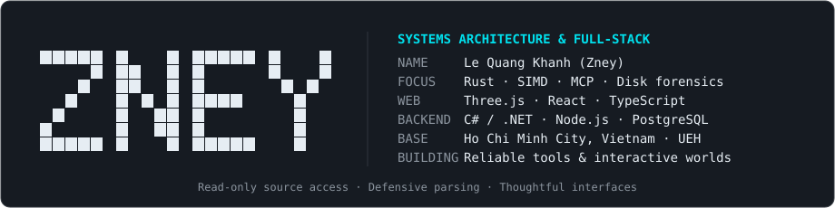

<div align="center">

# 

<p>
  <a href="https://zney295.id.vn/"></a>
  <a href="https://github.com/zney295/resc"></a>
  <a href="mailto:lequangkhanh295@gmail.com"></a>
  <a href="https://www.facebook.com/psyotic.zney/"></a>
</p>


</div>

<div align="center">



[Portfolio ↗](https://zney295.id.vn/) &nbsp; · &nbsp; [resc engine ↗](https://github.com/zney295/resc)

</div>

---

## ⚡ Executive Summary & Engineering Philosophy

<table>
<tr>
<td width="55%" valign="top">

### 👨‍💻 Who I Am
I am an **Information Technology Engineer** in training at the **University of Economics Ho Chi Minh City (UEH)** with a deep focus on bridging two worlds that rarely meet:
* **Low-Level Systems & Defensive Engineering:** Building memory-safe **Rust** engines, direct DMA/unbuffered hardware I/O layers, **SIMD (AVX2)** scanners, and zero-copy binary parsers.
* **Interactive 3D & Full-Stack Web:** Designing real-time collaborative applications (`WebRTC`, `WebSockets`), spatial **Three.js / WebGL** interfaces, and scalable backend services (`C# / .NET`, `Node.js`, `PostgreSQL`).

> *"Whether it is rendering 60FPS shaders on a browser canvas or parsing corrupted NTFS `$MFT` sectors in a RAM overlay, great engineering is about **precision, safety boundaries, and zero wasted cycles**."*

</td>
<td width="45%" valign="top">

### 🎯 Current Technical Focus
```yaml
name: Le Quang Khanh (Zney)
role: Systems & Full-Stack Engineer
institution: UEH University (HCMC)

active_research:
  - AI Agent Sandboxing via MCP (JSON-RPC)
  - In-Memory Copy-on-Write (CoW) Disk Overlays
  - 3D Web Graphics & Spatial UI (Three.js)
  - Windows System Daemons & Security (C#/Rust)

core_principles:
  - "100% Read-Only Hardware Safety"
  - "Zero-Copy & Token-Efficient Telemetry"
  - "Fuzz-Tested Defensive Parsing"
```

</td>
</tr>
</table>

---

## 🛡️ Flagship Systems Spotlight: [`resc`](https://github.com/zney295/resc)

<div align="center">
<table>
<tr>
<td width="100%">

### 🛡️ **resc** — Low-Level Disk Forensics & Data Recovery MCP Engine in Rust
*An AI-driven digital forensics sandbox that allows LLMs (Claude, Cursor, Gemini) to diagnose damaged drives, repair partition tables/boot sectors in RAM, and salvage data—without ever writing a single byte to physical hardware.*

<p align="center">
  
  
  
  
  
</p>

**Key Architectural Highlights:**
- **🧠 Hybrid "Brain & Muscle" Design:** Offloads multi-gigabyte raw sector scanning (`AVX2 SIMD`), Shannon entropy calculation ($0.0 - 8.0\text{ bits/byte}$), and zero-copy struct casting (`MBR`, `GPT`, `NTFS`, `FAT32`) to Rust, while sending `< 5KB` JSON anomaly maps to the AI Agent.
- **🔒 Hardware-Level Write Blocking & RAM Overlay:** Physical drives are opened strictly `GENERIC_READ` with `FILE_FLAG_OVERLAPPED` + `CancelIoEx` kernel watchdogs[cite: 2]. AI hex patches are applied to a `BTreeMap` in-memory Copy-on-Write overlay backed by a persistent Write-Ahead Log (`.wal`) and verified via native filesystem traversal before extraction[cite: 2].
- **📑 Forensic Chain-of-Custody:** Asynchronous non-blocking extraction with `O_NOFOLLOW` / `FILE_FLAG_OPEN_REPARSE_POINT` handle verification (TOCTOU protection), atomic `.part` clone/mapfile commits, and automated SHA-256 `.manifest.json` audit generation[cite: 2].

<p align="right">
  <a href="https://github.com/zney295/resc"><b>Explore the Architecture & Source Code →</b></a>
</p>

</td>
</tr>
</table>
</div>

---

## 🌟 Featured Engineering Portfolio

<div align="center">
<table>
<tr>
<td width="50%" valign="top">

### 🌌 [3D Cyberpunk Creator Portfolio](https://github.com/zney295/zney295.github.io)
**Interactive Spatial Web Experience**
- Custom 3D desktop workspace rendered in real-time with **Three.js / WebGL** & **React 18**.
- Features physics-based mechanical keyboard audio/visual simulation, custom shaders, and smooth camera transitions.
- **Tech:** `React 18` `TypeScript` `Three.js` `Tailwind CSS` `Vite`
- 🔗 **[Live Experience](https://zney295.id.vn/)** • **[GitHub Repo](https://github.com/zney295/zney295.github.io)**

</td>
<td width="50%" valign="top">

### 🎧 [BeatSync](https://github.com/zney295/beatsync)
**Real-Time Collaborative Audio Platform**
- Low-latency synchronized music listening rooms built on **WebRTC** data/audio channels and **WebSockets**.
- Sub-millisecond playback drift compensation and distributed room state synchronization.
- **Tech:** `TypeScript` `WebRTC` `WebSockets` `Node.js`
- 🔗 **[GitHub Repo](https://github.com/zney295/beatsync)**

</td>
</tr>
<tr>
<td width="50%" valign="top">

### 🔐 [Windows Security & Cloud Relay](https://github.com/zney295/Security)
**Proactive System Monitoring Daemon**
- Background Windows Service engineered in **C# / .NET** and **PowerShell** for hardware-level telemetry and anti-theft tracking.
- Evaluates virtualization-based security readiness and streams encrypted heartbeats through a cloud relay.
- **Tech:** `C#` `.NET` `Windows Services` `PowerShell`
- 🔗 **[GitHub Repo](https://github.com/zney295/Security)**

</td>
<td width="50%" valign="top">

### 🧠 [AI Heuristic TSP Solver](https://github.com/zney295/AI_Hill_Climbing_TSP) & [LearningEnglish](https://github.com/zney295/LearningEnglish)
**Algorithmic Optimization & NLP Parsing**
- **TSP Solver:** Heuristic Hill-Climbing search optimization solving complex routing graphs.
- **LearningEnglish:** Automated grammatical tense verification and syntactic structure parser.
- **Tech:** `Algorithms` `NLP` `Full-Stack Web`
- 🔗 **[TSP Repo](https://github.com/zney295/AI_Hill_Climbing_TSP)** • **[NLP App Repo](https://github.com/zney295/LearningEnglish)**

</td>
</tr>
</table>
</div>

---

## 🛠️ Technical Arsenal & Ecosystem

<div align="center">

[](https://skillicons.dev)

</div>

<br />

<div align="center">

| Domain | Core Competencies & Production Tooling |
| :--- | :--- |
| **⚙️ Systems & Forensics** |      |
| **🎨 Frontend & 3D Graphics** |      |
| **🚀 Backend & Distributed** |      |
| **🗄️ Data & Infrastructure** |      |

</div>

<details>
<summary><b>🔍 Click to expand: Deep-Dive into My Engineering Workflow & Environments</b></summary>
<br />

- **Systems & Virtualization Lab:** Experienced in configuring multi-OS virtualization environments (`VMware Workstation`, `WSL 2`, `Docker Containers`, `Linux / Pop!_OS`) and low-level hardware debugging.
- **Database Architecture & Process Mining:** Skilled in complex relational schema design, stored procedures, set operations in `SQL Server (SSMS)` / `PostgreSQL`, and transforming raw interaction logs into event pipelines for `Celonis Process Mining`.
- **AI-Native Engineering:** Designing structured `.agents/skills/` playbooks, decision trees, and deterministic tool schemas to turn LLMs into reliable systems co-pilots[cite: 2].

</details>

---

## 📊 GitHub Telemetry & Contribution Analytics

<div align="center">

<!-- DÒNG 1: STATS & STREAK CÂN XỨNG -->
<p align="center">
  
  
</p>

<!-- Top languages ranked by repository count. -->
<p align="center">
  
</p>

<!-- DÒNG 3: NẾU VẪN MUỐN DÙNG GRAPH, DÙNG THÊM CỜ CACHE_SECONDS ĐỂ GIẢM LỖI -->
<p align="center">
  
</p>

</div>
---

## 📫 Connect & Collaborate

<div align="center">

I am always open to discussing **Systems Programming (Rust/C#)**, **AI Agent Infrastructure (MCP)**, **Interactive 3D Web Projects**, or **Software Engineering Opportunities**.

| Platform | Handle / Endpoint | Action |
| :---: | :---: | :---: |
| **🌐 3D Web Portfolio** | `zney295.id.vn` | **[Launch Interactive Portfolio ↗](https://zney295.id.vn/)** |
| **🛡️ Flagship Project** | `github.com/zney295/resc` | **[Explore `resc` Forensics Engine ↗](https://github.com/zney295/resc)** |
| **📫 Direct Email** | `lequangkhanh295@gmail.com` | **[Send an Email ↗](mailto:lequangkhanh295@gmail.com)** |
| **💬 Facebook** | `fb.com/psyotic.zney` | **[Connect on Facebook ↗](https://www.facebook.com/psyotic.zney/)** |

<br />


</div>
